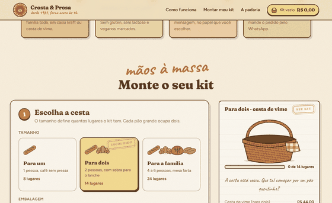
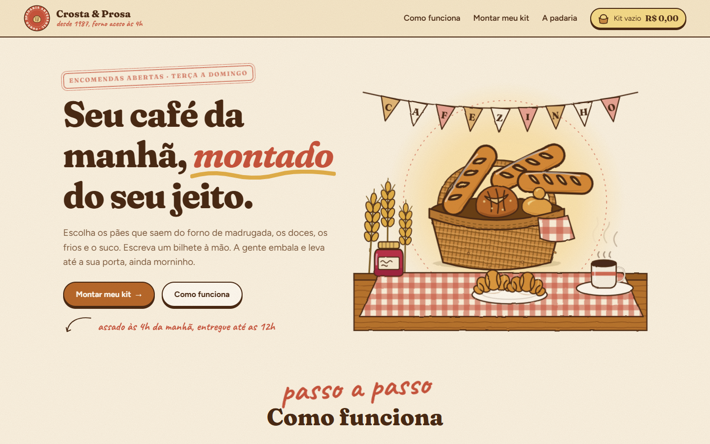
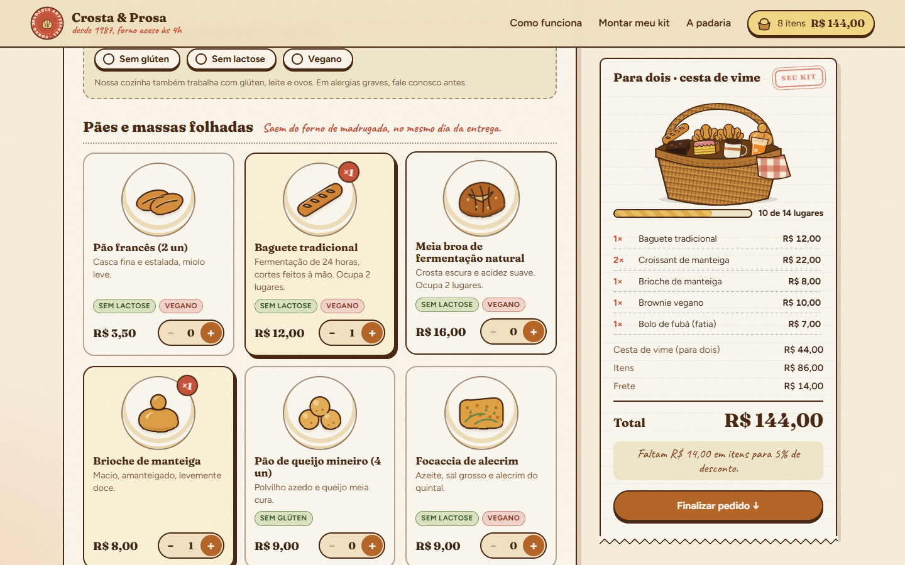
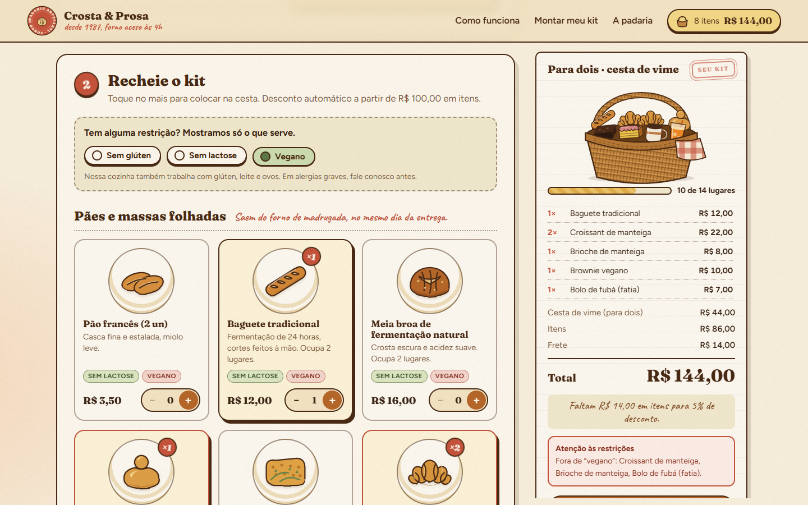
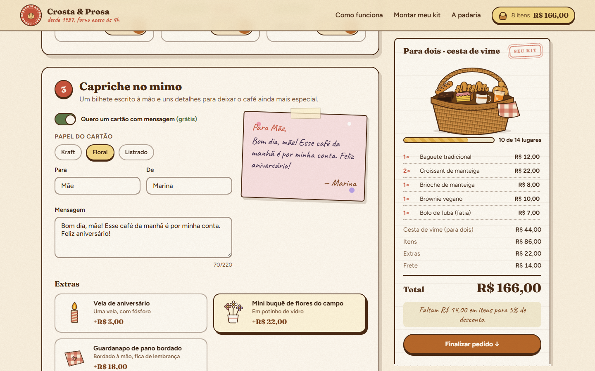
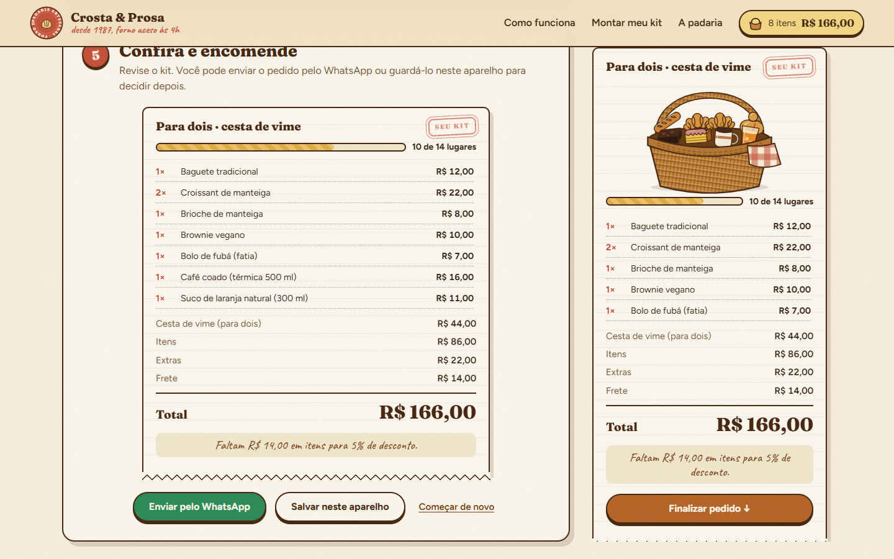
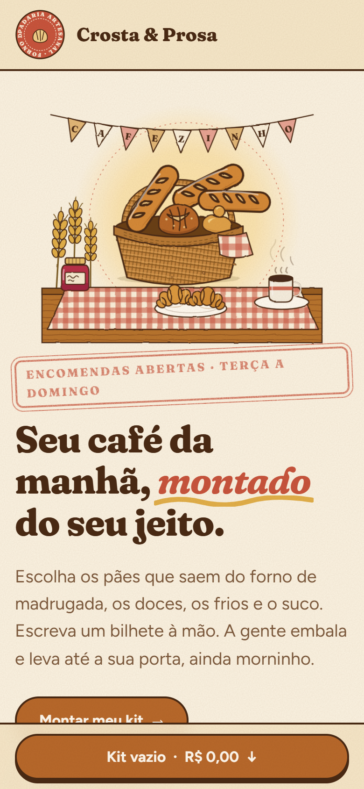
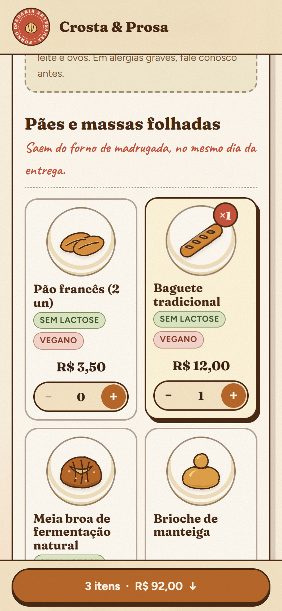

# Crosta & Prosa · Kit Café da Manhã

Site de uma padaria artesanal fictícia onde o cliente monta e encomenda o próprio kit de café da manhã: tamanho, cesta ou caixa, pães, doces, frios, bebidas, restrições alimentares, cartão escrito à mão, data e janela de entrega. O preço atualiza ao vivo e o pedido sai pelo WhatsApp com a mensagem pronta. HTML, CSS e JavaScript puros, sem build e sem backend.

[](https://github.com/luizrenatodc/padaria-kit-cafe/actions/workflows/testes.yml)
[](LICENSE)

**Ao vivo:** <https://luizrenatodc.github.io/padaria-kit-cafe/>



## Veja funcionando



| Montagem com cesta e ticket ao vivo | Restrições alimentares |
|---|---|
|  |  |

| Cartão com mensagem | Confira e encomende |
|---|---|
|  |  |

| Celular | Celular |
|---|---|
|  |  |

## O que o cliente consegue personalizar

| Etapa | O que tem |
|---|---|
| Cesta | Para um (8 lugares), para dois (14) ou para a família (24), em caixa kraft ou cesta de vime que fica com o cliente |
| Itens | 10 pães e massas folhadas, 8 doces, 9 frios, geleias e pastas, 6 bebidas. Pão grande e térmica ocupam dois lugares |
| Restrições | Sem glúten, sem lactose e vegano. Mostra só o que serve, e o item que já estava no kit e quebra a restrição fica sinalizado |
| Mimo | Cartão grátis em três papéis (kraft, floral, listrado) com prévia em letra manuscrita, mais vela, flores e guardanapo bordado |
| Entrega | Entrega ou retirada, data, três janelas (madrugadão, café clássico, brunch), endereço e observações |
| Fechamento | Enviar por WhatsApp com mensagem montada (com prévia e botão de copiar) ou guardar o pedido neste aparelho |

O kit em andamento é salvo sozinho no navegador. Se a pessoa fechar a página, volta de onde parou.

## Como o preço é calculado

```text
total = embalagem (tamanho x tipo)
      + itens - desconto progressivo sobre os itens
      + extras
      + frete (retirada: zero)
      + taxa da janela madrugadão
```

- **Desconto:** 5% a partir de R$ 100,00 em itens e 10% a partir de R$ 180,00. Não incide em embalagem, extras nem entrega.
- **Frete:** R$ 14,00, grátis quando os itens, já com desconto, chegam a R$ 160,00. O ticket diz quanto falta.
- **Capacidade:** cada item ocupa um ou dois lugares. Se não cabe, o botão avisa o motivo em vez de aceitar. Ao trocar para um tamanho menor, saem os últimos itens adicionados até caber.
- **Datas:** a padaria descansa às segundas. Pedido feito até as 18h entra para o dia seguinte, depois disso só no outro dia. Aceita até 30 dias à frente.
- Valores em centavos inteiros, sem erro de ponto flutuante.

## Como é por dentro

```text
site/
  index.html          estrutura e textos
  css/estilo.css      paleta, tipografia, carimbos, animações, responsivo
  js/dados.js         catálogo, tamanhos, janelas, regras (dados fictícios)
  js/kit.js           regras puras: capacidade, preço, restrições, datas, mensagem
  js/ilustracoes.js   desenhos SVG de cada item, cesta, caixa e cena do topo
  js/app.js           interface: eventos, renderização, rascunho, pedidos guardados
test/kit.test.js      35 testes da lógica
scripts/              servidor local, capturas e GIF
```

**Regras sem DOM.** Tudo o que decide dinheiro e validade está em `kit.js`, em funções puras que recebem o estado e o "agora". Os testes fixam a data (um sábado), então não dependem do relógio da máquina.

**Desenho feito à mão.** Cada pão, doce e pote é um `<symbol>` SVG com três cores variáveis (`--a`, `--b`, `--c`), então um mesmo desenho serve para vários itens (a geleia e o requeijão usam o mesmo pote). Um filtro de turbulência dá o traço tremido de nanquim, e outro, o furinho de tinta dos carimbos. A cesta do ticket reorganiza as ilustrações dos itens escolhidos, e os recém-adicionados "pousam" nela.

**Acessibilidade.** Cartões de opção são `input` de rádio de verdade, com foco visível. Os erros do formulário aparecem junto do campo, com `aria-invalid`. O total e a barra de lugares têm papel e rótulo. `prefers-reduced-motion` desliga vapor, farelo e entradas animadas.

## Como rodar

```bash
npm start        # http://localhost:8080 (módulos ES pedem http, não file://)
npm test         # 35 testes
```

Sem dependências. As fontes (Fraunces, Caveat e Figtree) vêm do Google Fonts; sem internet o site usa fontes do sistema.

## Publicação

O workflow `pages.yml` publica a pasta `site/` no GitHub Pages a cada push em `main`, e `testes.yml` roda os testes.

## Gerar as capturas e o GIF

```bash
npm install puppeteer-core            # fora do projeto, só para as capturas
node scripts/telas.mjs                # grava docs/*.png e os quadros do GIF
python scripts/montar_gif.py 560      # monta docs/montagem.gif (requer Pillow)
```

## Limites conhecidos

- **Nenhum pedido é entregue.** A padaria é inventada e o número de WhatsApp em `dados.js` é um valor de demonstração. Por isso o botão mostra uma prévia da mensagem com opção de copiar antes de abrir o WhatsApp.
- **Sem backend.** Não há pagamento, estoque nem confirmação de pedido. Pedidos guardados ficam só no `localStorage` do aparelho.
- **Restrições alimentares são informativas.** O site avisa o que foge da restrição marcada, mas não substitui o contato com a padaria em casos de alergia grave, como o próprio site diz.
- **Datas pelo relógio do navegador**, sem feriados.
- **Fontes externas** do Google Fonts.

## Sobre este projeto

Projeto de demonstração, com padaria, cardápio, preços e endereços fictícios, criado para mostrar design, ilustração em SVG e lógica de pedido no front-end.

## Autor

**Luiz Renato Carvalho**, Engenheiro de Software e IA · [luizrenato.dev](https://www.luizrenato.dev) · [LinkedIn](https://linkedin.com/in/luizrenatodc)
